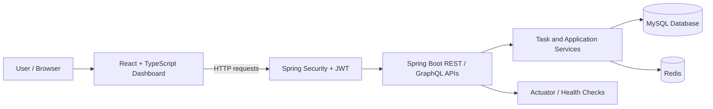
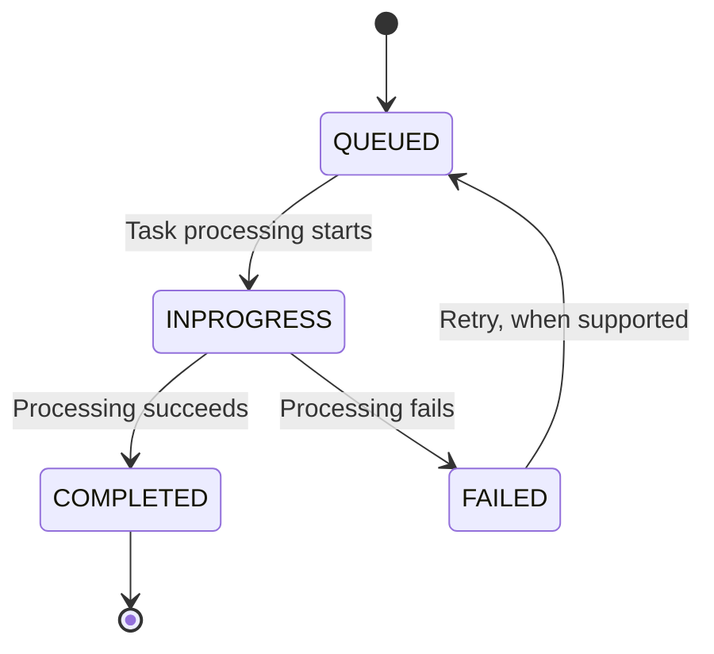

SpringQueuePro
<u>Version</u>: <b>1.0</b> (improvements expected to come) 

<u>Author</u>: <b>Aadarsh Wadandre</b>

<u>Date</u>: <b>10/16/2026</b> (project configuration and documentation updated).

<u>Description</u>: <b>A task queue management application built with Java 17, Spring Boot, Redis, MySQL, GraphQL, REST APIs & React-TypeScript (among various other technologies).</b>

Table of Contents
- Overview
- Key Features
- System Architecture
- Task Lifecycle
- Tech Stack
- Prerequisites
- Project Structure
- Local Setup
- Environment Configuration
- API Endpoints
- Database Configuration
- Redis Configuration
- Health and Monitoring
- Testing
- Troubleshooting
- Security Notes
- Future Improvements
- Author
Overview
SpringQueuePro Application is a full-stack task queue management project. It combines a Spring Boot backend with a React dashboard and supporting infrastructure services. The application is intended to demonstrate backend API development, task management, persistence, authentication, and operational health monitoring.
The project has two main parts:
- Backend: Java and Spring Boot application exposing REST and GraphQL APIs, handling authentication, task operations, database access, and health checks.
- Frontend: React and TypeScript dashboard for interacting with tasks and viewing task-related information.
- Database: MySQL stores persistent application data.
- Redis: Supports configured features such as coordination, caching, or token storage.
Key Features
- Task creation and task-status management through the application APIs.
- REST API and GraphQL API support.
- JWT-based authentication configuration.
- MySQL database integration using Spring Data JPA/Hibernate.
- Redis integration for configured application features.
- Health checks for backend dependencies.
- Frontend dashboard built with React and TypeScript.
- Maven-based backend build.
- Docker-based local infrastructure for MySQL and Redis.
The exact behavior of each feature depends on the current implementation in the source code.

System Architecture
The application follows a layered architecture:
- Presentation Layer: React and TypeScript dashboard.
- API Layer: Spring Boot REST controllers and GraphQL controllers.
- Security Layer: Spring Security and JWT authentication.
- Service Layer: Application services for task operations and processing.
- Persistence Layer: Spring Data JPA/Hibernate with MySQL.
- Supporting Services: Redis and Spring Boot Actuator/health checks where configured.
High-Level Architecture Diagram

Task Lifecycle
A typical task workflow can be represented as:

The diagram is conceptual. Actual state names, transitions, retry rules, and scheduling behavior should match the implementation in the backend code.
Tech Stack
Languages and Runtime
- Java 17
- TypeScript
- JavaScript
- SQL
Backend
- Spring Boot
- Spring Web / REST APIs
- Spring Data JPA and Hibernate
- Spring Security
- Spring GraphQL
- Maven
Database and Supporting Services
- MySQL
- Redis
- Docker
Frontend
- React
- TypeScript
- Vite
- HTML and CSS
Monitoring and Testing
- Spring Boot Actuator
- JUnit / Spring Boot Test, where configured
- Git and GitHub
Prerequisites
Install the following tools before running the project:
- JDK 17
- Node.js and npm
- Docker Desktop (for running MySQL and Redis containers)
- Git
- An IDE such as IntelliJ IDEA or VS Code
Verify the Java and Node.js installations:
java -version
node -v
npm -v
Project Structure
The repository is organized into backend and frontend projects:
SpringQueuePro-Application/
├── springqpro-backend/
│   ├── src/
│   │   ├── main/
│   │   │   ├── java/
│   │   │   └── resources/
│   │   └── test/
│   ├── pom.xml
│   └── mvnw
├── springqpro-frontend/
│   ├── src/
│   ├── package.json
│   └── vite.config.*
└── README.md
Some filenames or folders may differ as the project evolves.
Local Setup
1. Clone the repository
git clone https://github.com/Aadarsh1125/SpringQueuePro-Application.git
cd SpringQueuePro-Application
2. Start MySQL
If your local setup uses the existing Docker container, start it:
docker start springqueue-mysql
The project has previously been configured to expose MySQL on host port 3307. Confirm your container and database settings before starting the backend.
To check running containers:
docker ps
3. Start Redis
If Redis is already created as a Docker container:
docker start springqueue-redis
Confirm the container is running:
docker ps
If you have not created the containers yet, create them according to your local database credentials and application configuration. Do not reuse example passwords in production.
4. Configure backend environment variables
Set the required environment variables in your IDE run configuration or terminal. See Environment Configuration.
5. Run the backend
Open a terminal in the backend folder:
cd springqpro-backend
On Windows, use the Maven wrapper if available:
.\mvnw.cmd spring-boot:run
If the wrapper is unavailable but Maven is installed, use:
mvn spring-boot:run
The backend is configured to use port 8080 unless the application configuration overrides it.
6. Run the frontend
Open a second terminal:
cd springqpro-frontend
npm install
npm run dev
Open the local URL printed by Vite in the terminal, commonly http://localhost:5173.
Environment Configuration
Configure these variables in your local IDE run configuration or operating-system environment. Do not commit real credentials to GitHub.
Variable	Purpose	Example for local development
DB_URL	MySQL JDBC URL	jdbc:mysql://localhost:3307/springqueue_db
DB_USERNAME	MySQL application username	springqueue_app
DB_PASSWORD	MySQL application password	Set your local password
JWT_SECRET	Secret used to sign JWTs	Use a newly generated secret
REDIS_HOST	Redis hostname, if read by configuration	localhost
REDIS_PORT	Redis port, if read by configuration	6379

The actual variable names required depend on the active Spring profile and configuration files. Check application.properties, application.yml, and profile-specific YAML files before running the application.
API Endpoints
The following are common endpoint patterns referenced by the project configuration. Verify the exact routes in the current controller classes.
Endpoint	Purpose
/graphql	GraphQL API
/auth/**	Authentication routes, where configured
/api/tasks/**	Task-related REST routes, where configured
/actuator/health	Spring Boot health endpoint, if enabled
/api/internal/health	Project-specific internal health endpoint, if enabled

For protected routes, use a valid access token in the request header:
Authorization: Bearer <access-token>
Do not use a refresh token as an API access token.
Database Configuration
The application uses MySQL for persistent data in the current local setup.
Example JDBC URL:
jdbc:mysql://localhost:3307/springqueue_db
Confirm the following before running the backend:
- MySQL container or service is running.
- The configured host port matches the port mapping.
- The database exists.
- The configured application user has the required permissions.
- DB_URL, DB_USERNAME, and DB_PASSWORD match the active Spring configuration.
Do not place production database credentials directly in source files.
Redis Configuration
Redis is used by the application for configured supporting functionality. Depending on the active code and profile, this may include token storage, caching, coordination, or health checks.
For a local Redis instance, the usual connection is:
Host: localhost
Port: 6379
Make sure the Redis container is running and that the application is configured to use the correct host and port.
Health and Monitoring
The project includes backend health-check functionality. A health endpoint may report the status of the application and dependencies such as the database and Redis.
Example local URLs, if enabled in the active configuration:
http://localhost:8080/actuator/health
http://localhost:8080/api/internal/health
The internal health route should be secured appropriately before deployment. Avoid exposing detailed infrastructure status publicly in production.
Testing
Run backend tests from the backend directory:
.\mvnw.cmd test
Or, if Maven is installed:
mvn test
Tests that depend on Docker, MySQL, Redis, or Testcontainers require those services and dependencies to be configured correctly. Review the test configuration and current test results before relying on them.
For frontend checks, use the scripts available in springqpro-frontend/package.json, for example:
npm run
This lists the scripts configured for the frontend project.
Troubleshooting
Backend cannot connect to MySQL
- Confirm the MySQL container is running with docker ps.
- Verify that the host port is 3307 if that is the port mapping used locally.
- Check DB_URL, DB_USERNAME, and DB_PASSWORD.
- Confirm the database and application user exist.
Redis health check fails
- Confirm the Redis container is running.
- Verify the configured Redis host and port.
- Review the backend startup logs for connection errors.
JWT or authentication errors
- Use an access token for protected API calls.
- Check that the frontend is sending the token in the Authorization header.
- Verify JWT_SECRET is set consistently for the running backend.
- Log in again if the access token has expired.
Frontend cannot reach the backend
- Confirm the backend is running on port 8080.
- Verify the API base URL in the frontend configuration.
- Check browser developer tools for network errors and CORS messages.
Maven build fails
- Confirm Java 17 is selected in the terminal and IDE.
- Check Maven dependency resolution and the backend pom.xml.
- Read the first meaningful error in the build output rather than only the final failure summary.
Security Notes
- Never commit .env files, passwords, database credentials, or JWT secrets.
- If any secret was committed or shared, rotate it; deleting it from the latest file does not remove it from Git history.
- Use a strong, newly generated JWT_SECRET.
- Keep internal health and administration endpoints protected.
- Do not disable authentication annotations as a permanent production fix.
- Use separate credentials and configuration for development and production.
- Configure a real production database and Redis service instead of using localhost fallbacks.
Future Improvements
Potential improvements for future versions:
- Improve task status and queue-depth reporting.
- Expand automated unit and integration test coverage.
- Add clear API documentation and request examples.
- Improve frontend loading, empty, and error states.
- Add structured logging and more detailed operational metrics.
- Add CI checks for backend tests and frontend build.
- Prepare deployment-specific configuration for a cloud environment.
These are suggestions, not claims that the features are already implemented.
Author
Aadarsh Wadandre
GitHub: Aadarsh1125
Project Repository: SpringQueuePro-Application
If you find an issue or want to improve the project, open an issue or submit a pull request in the repository.
