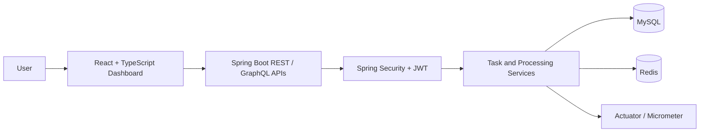
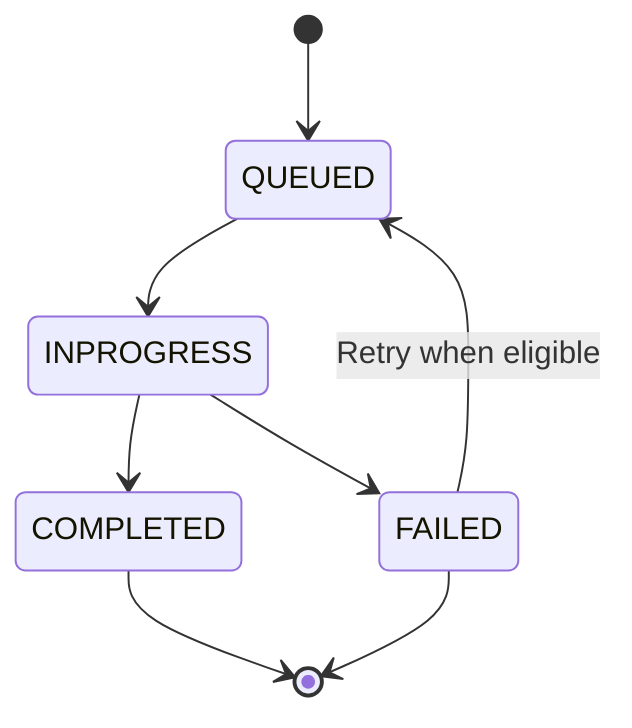

SpringQueuePro Application
Version: 1.0
Author: Aadarsh Wadandre
Last Updated: 16 October 2026
SpringQueuePro is a task-queue management application built with Java 17, Spring Boot, MySQL, Redis, GraphQL, REST APIs, and React with TypeScript. It provides APIs and a web dashboard to create and manage tasks, track their processing status, and monitor application health.
GitHub Repository: https://github.com/Aadarsh1125/SpringQueuePro-Application
Overview
The application is organized into two main parts:
- Backend: Spring Boot REST and GraphQL APIs, authentication, task processing, persistence, and health/metrics endpoints.
- Frontend: React and TypeScript dashboard for interacting with tasks and viewing system health.
The backend uses MySQL for persistent application data and Redis for supporting features such as coordination, caching, or token-related storage where configured.
Key Features
- User authentication with JWT-based access control.
- Task creation and task management through GraphQL and REST APIs.
- Task status tracking, including QUEUED, INPROGRESS, COMPLETED, and FAILED.
- Background task processing with configurable worker settings.
- Task-handler architecture for supported task types.
- Retry and failure-handling logic.
- Redis integration.
- System health endpoint and Micrometer metrics support.
- React dashboard for task management and system-health overview.
Exact behavior depends on the current implementation and active configuration. Check the source code and application configuration before describing a feature as production-ready.

Technology Stack
Area	Technologies
Language	Java 17
Backend	Spring Boot 3, Spring Web, Spring Data JPA
APIs	REST, Spring GraphQL
Database	MySQL
Cache / coordination	Redis
Security	Spring Security, JWT
Frontend	React, TypeScript, Vite
Monitoring	Spring Boot Actuator, Micrometer
Build tools	Maven, npm
Local services	Docker

Architecture Overview

Task Lifecycle
A task can move through the following states, depending on the task handler and processing outcome:

Local Development Setup
Requirements
- Java 17
- Node.js and npm
- Maven or the included Maven Wrapper
- Docker Desktop (if using Docker for MySQL and Redis)
- MySQL and Redis services
1. Clone the repository
git clone https://github.com/Aadarsh1125/SpringQueuePro-Application.git
cd SpringQueuePro-Application
2. Configure backend environment variables
Configure these values in your IDE run configuration or local environment. Use your own credentials; do not commit real passwords or secrets.
DB_URL=jdbc:mysql://localhost:3307/springqueue_db
DB_USERNAME=<your_mysql_username>
DB_PASSWORD=<your_mysql_password>
JWT_SECRET=<a_long_random_secret>
The database URL above matches the local Docker port mapping used during development. Change it if your MySQL instance uses another port or database name.
If Redis is configured through environment variables, set the variables required by your active Spring profile as well.
3. Start the backend
From the backend directory:
.\mvnw.cmd spring-boot:run
The backend is configured to run on port 8080 unless the application configuration overrides it.
4. Start the frontend
From the frontend directory:
npm install
npm run dev
Vite commonly serves the frontend at http://localhost:5173.
Useful Endpoints
Purpose	Endpoint
GraphQL API	POST /graphql
Authentication	/auth/**
Internal system health	GET /api/internal/health
Actuator health	GET /actuator/health
Actuator metrics	/actuator/metrics
Prometheus metrics	/actuator/prometheus (if exposed by the active profile)

Protected endpoints may require a valid access token. A refresh token should only be sent to the refresh endpoint, not used as an API access token.
Configuration and Security Notes
- Keep database credentials in environment variables or a local, untracked configuration file.
- Use a strong, randomly generated JWT_SECRET.
- Never commit .env files, passwords, tokens, private keys, or production secrets.
- If a secret was previously committed, rotate it. Removing it from the latest file does not remove it from Git history.
- Before deploying, verify the active Spring profile, database URL, Redis connection settings, CORS rules, and exposed Actuator endpoints.
- Avoid enabling detailed health information or sensitive management endpoints publicly unless access is appropriately restricted.
Project Structure
SpringQueuePro-Application/
├── springqpro-backend/
│   ├── src/main/java/
│   ├── src/main/resources/
│   │   ├── application.properties
│   │   ├── application.yml
│   │   ├── application-prod.yml
│   │   └── graphql/
│   └── pom.xml
└── springqpro-frontend/
    ├── src/
    ├── package.json
    └── vite.config.*
The exact structure may evolve as the project changes.
Current Development Notes
- The local development setup has been configured to use MySQL on port 3307 and Redis on port 6379.
- The system-health dashboard has displayed UP for the database, Redis, disk-space, ping, and SSL health components in a successful local run.
- Queue-depth metrics may display N/A when the corresponding metric is not registered or exposed. This should be verified against the actual metric registry and processing implementation.
Future Improvements
- Improve queue-depth and task metric visibility in the dashboard.
- Expand automated integration and end-to-end test coverage.
- Add clearer deployment instructions and environment-specific configuration.
- Improve responsive dashboard design and error handling.
- Document CI/CD and deployment steps once they are validated for the target hosting environment.
Maintainer
Aadarsh Wadandre
GitHub: https://github.com/Aadarsh1125
For issues or suggestions, open an issue in the repository.
